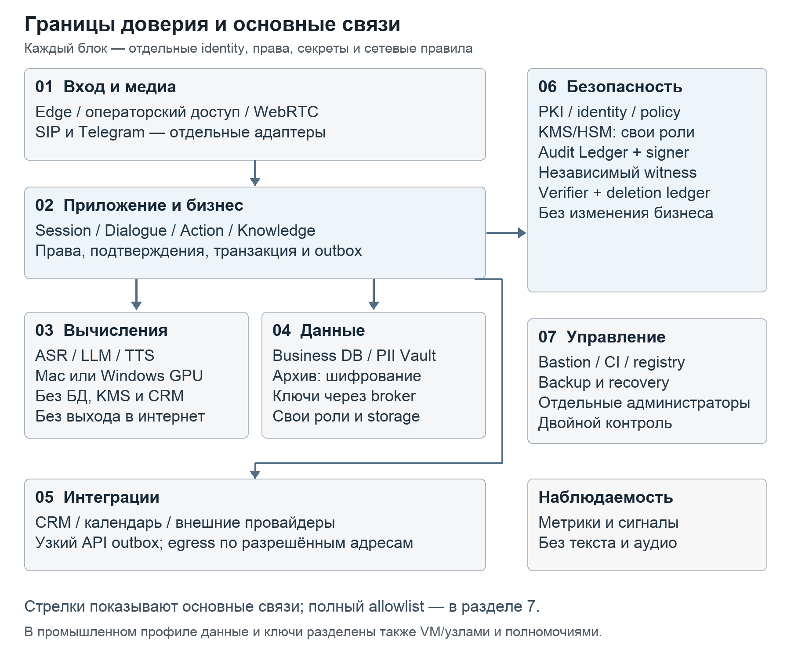

# План совершенствования и защиты голосовой платформы Точка

Версия 1.0 · 13 октября 2026 года

Проектное решение и программа внедрения для владельца продукта, архитекторов, разработчиков, инженеров эксплуатации, специалистов ИБ и приёмочной команды.

Платформу следует развивать на основе существующего транзакционного ядра: повысить качество русской речи и диалога, выделить заменяемые модули, разделить зоны доверия и обеспечить проверяемую защиту персональных данных на всём жизненном цикле. Полный перенос на стороннюю голосовую платформу на первом этапе не требуется.

Документ задаёт целевое состояние, обязательные меры усиленного промышленного профиля, последовательность миграции и доказательства для приёмки. Выполнение плана не означает математической гарантии отсутствия взлома. Защита строится против явно описанных угроз, регулярно проверяется и сохраняет работоспособность при отказах отдельных компонентов.

## 1 Назначение и границы программы

После прочтения команда должна уметь разбить работы на задачи, реализовать очередной модуль без нарушения контрактов, проверить его безопасность и выпустить изменение с подтверждёнными показателями качества. Владельцу продукта документ позволяет выбрать профиль размещения и принимать этапы по результатам испытаний.

В программу входят русский голосовой клиент, чат, запись на услуги, подтверждения и отмены, кабинет, архив, согласия, CRM, WebRTC, SIP, Telegram, знания, память, эксплуатация и программные интеграции. Для операторского продукта отдельно учитываются организации, номера, жизненный цикл услуги, масштабирование и учёт использования.

Существующие минимумы точности слов и определения намерения по 94% сохраняются. Дизайн Точки, утверждённые голоса и логотип сохраняются; лендинг и рабочий кабинет остаются раздельными. Интеграции выполняют реальные операции через разрешённый API. Модели не получают самостоятельного права подтверждать бизнес-действия.

Техническое развитие не заменяет решения о правовых основаниях обработки, сроках хранения, месте размещения, договоре с оператором связи и допустимости конкретного внешнего обработчика. Эти решения оформляются владельцем данных до передачи реальных данных в соответствующий контур. Отправка голоса и текста во внешние модельные API по умолчанию запрещена.

## 2 Состояние проекта и основания для изменений

На текущем Mac используется Apple M4 с 16 GiB общей памяти. Загружаемая конфигурация содержит Whisper turbo через whisper.cpp и Metal, Qwen3-4B и Qwen3-TTS. Голосовой тракт построен на Pipecat. Рабочая конфигурация конкретного процесса должна подтверждаться его manifest: переменные окружения запуска могут отличаться от файлов настроек.

Уже реализованы раннее распознавание после 120 мс тишины, предварительная подготовка намерения, отмена устаревших результатов, потоковый синтез и кеш публичных фраз. Есть транзакции записи, ревизии черновиков, идемпотентность, ограничение пересечений слотов PostgreSQL и CRM outbox. Сохранить эти гарантии при разделении сервисов обязательно.

В области ИБ уже присутствуют персональные учётные записи и разрешения, проверка принадлежности ресурсов, согласие на запись, retention, AES-256-GCM для архивных объектов, шифрованные backup и связанный HMAC-аудит. Поэтому задача состоит в расширении покрытия и независимости защиты, а не в добавлении шифрования с нуля.

### 2.1 Подтверждённые ограничения

| Область | Наблюдаемое состояние | Следствие для плана |
| --- | --- | --- |
| Диалог | Быстрый ответ о цене перехватывает запрос о цене вместе с просьбой записать | Ввести составные намерения и сохранить названные поля |
| Доступное время | API слотов есть, голосовой диалог его не использует | Добавить чтение реального расписания как инструмент |
| Границы процессов | Основной backend объединяет модели, диалог, бизнес, медиа, архив и фоновые работы | Разделить полномочия и владение данными |
| Ключи | Один локальный master key используется для архива и HMAC-аудита | Раздельные ключи и независимый KMS и signer |
| Рабочие данные | Имена, телефоны и часть диалога находятся в рабочих таблицах PostgreSQL в открытом прикладном виде | Выделить PII Vault и шифровать чувствительные payload |
| Аудит | Есть previous_hash и HMAC, нет независимого внешнего якоря и полного verifier | Защититься от переписывания, усечения и отката истории |
| Backup | Проверено восстановление основной БД, не всего комплекса | Принять совместное восстановление БД, CRM, ключей, архива и каналов |
| Удаление | Старая копия может содержать уже удалённые данные | Независимый реестр удалений и карантин восстановления |
| Контейнеры | Основной Compose разделяет БД и CRM, но не всё приложение и его полномочия | Ввести контуры и проверяемую сетевую матрицу |

Это ограничения архитектуры по коду и локальным проверкам, а не результаты внешнего penetration test. Старые документы с утверждениями об отсутствии аудиоархива или персональных учётных записей не должны использоваться как актуальная инвентаризация.

### 2.2 Что показывают измерения

В сохранённом браузерном прогоне FAQ мужским голосом имеет медиану 2,06 с на пяти наблюдениях до декодированного звука. Один сценарий подготовки к консультации занял 8,69 с и не прошёл проверку содержания. Женский профиль в этом прогоне проверен неполно. Эти результаты не являются приёмочной оценкой p95 и не измеряют звук физического динамика.

Сохранённое сравнение компактного извлечения на 36 сценариях: Qwen3-4B прошла 28 сценариев при медиане 1,27 с, Qwen3.5-2B — 23 при 1,09 с. После этого изменялись ограничения извлечения. Результаты нельзя объявлять качеством последнего кода или другой конфигурации запуска.

На небольшом TTS-наборе с кешированием референса медиана отношения времени синтеза к длительности звука составила около 1,01 при интервале 0,32 с и 1,31 при 0,16 с. Более ранний первый фрагмент сопровождался ухудшением непрерывной производительности. Требуется испытание полных разговоров под совместной нагрузкой моделей.

В проверке сегментации 35 аудиопримеров пороги тишины 450, 650 и 950 мс дали соответственно 22, 11 и 0 многосегментных реплик. Это обосновывает отдельное определение конца мысли вместо механического сокращения таймера. Требования ASR ≥94% и NLU ≥94% пока не подтверждены [P1–P4].

## 3 Целевые свойства и приоритеты

Платформа должна корректно понимать запрос, сохранять существенные ограничения, отвечать по проверяемым данным и выполнять только разрешённые подтверждённые действия. Быстрый, но неверный ответ не считается улучшением. Короткая служебная фраза не подменяет время до содержательного ответа.

| Приоритет | Результат | Условие допуска |
| --- | --- | --- |
| P0 | Защита данных и правдивость действий | До внешнего пилота с реальными данными |
| P1 | Качество речи, низкая задержка и устойчивость | До приёмки голосового продукта |
| P2 | Масштабирование и дополнительные каналы | По утверждённому паспорту нагрузки |
| P3 | Новые языки, платформы и исследовательские модели | После независимого сравнительного испытания |

Усиленный промышленный профиль является целевым для реальных клиентских данных. Локальный Mac остаётся средой разработки и ограниченного испытания. Контейнеры на одном хосте не предоставляют независимости от администратора или компрометации ядра этого хоста.

## 4 Модель угроз и границы гарантий

Активы: аудио, текст, контакты, записи на услуги, согласия, секретные ссылки, учётные записи, ключи, токены интеграций, журналы, резервные копии, модели и конфигурация сценариев. Метаданные разговора и псевдонимы также считаются чувствительными, если могут быть связаны с человеком.

| Угроза | Возможное последствие | Основная защита |
| --- | --- | --- |
| Внешний атакующий | Подбор доступа, перегрузка, эксплуатация API или медиапарсера | Пограничные лимиты, аутентификация, минимальные поверхности |
| Чужой клиент или организация | Доступ к чужому разговору, записи или кешу | Проверка объекта и организации, RLS и раздельные ключи |
| Prompt injection голосом или документом | Выполнение лишнего инструмента, утечка контекста | Недоверенные входы, типизированные инструменты, серверные права |
| Компрометация адаптера | Кража ключей CRM, движение внутрь сети | Отдельная зона интеграций, ограниченный egress и секреты |
| Злоупотребление сотрудника | Массовая выгрузка или скрытый просмотр | Минимальные права, MFA, цель доступа, двойное подтверждение |
| Компрометация приложения или DBA | Изменение данных и журнала, откат backup | AEAD, внешний signer и witness, разделение полномочий |
| Компрометация хоста inference | Чтение голоса и текста в памяти | Отдельный доверенный хост, минимизация и контроль памяти |
| Подмена образа или модели | Вредоносный код либо поведение модели | Подписи, provenance, digest, карантин импорта |
| Потеря ключа или ransomware | Недоступность данных | Изолированные backup и проверенное восстановление ключей |

Криптография не мешает уже уполномоченному процессу прочитать данные, необходимые ему для работы. Владелец памяти хоста inference может получить обрабатываемую речь. Подпись доказывает происхождение записи от ключа, но не истинность события. Эти остаточные риски уменьшаются разделением контуров, полномочий и наблюдением.

Ни одна сервисная учётная запись не должна одновременно управлять бизнес-БД, раскрывать все ключи, переписывать аудит и удалять резервные копии. Dev, test, staging и production имеют разные удостоверяющие центры, секреты, данные и права. Копирование боевых разговоров в тесты по умолчанию запрещено.

## 5 Архитектура заменяемых модулей

Каждый модуль имеет владельца, контракт, разрешённые зависимости, перечень данных, версию, набор контрактных тестов и процедуру отката. Логическая модульность внедряется раньше сетевого разбиения. Через границу безопасности модуль запускается отдельным процессом, контейнером или VM. Простое перемещение Python-файлов в разные каталоги изоляцией не считается.

### 5.1 Состав модулей

| Модуль | Ответственность и состояние | Граница замены |
| --- | --- | --- |
| Public Edge | TLS, лимиты, маршрутизация; без бизнес-состояния | Reverse proxy и публичный API |
| Operator Gateway | Кабинет и административные запросы | Отдельный BFF и политика доступа |
| Identity and Policy | Люди, сервисные identity, роли и контекст доступа | OIDC и серверная авторизация |
| Session Runtime | Жизненный цикл звонка, очередь и lease | API сессий и события |
| Media Gateway | WebRTC, PCM, перебивания и операторский мост | Версионированный медиаконтракт |
| Turn Controller | Начало речи, конец мысли и отмена поколения | Сменяемые VAD и turn strategies |
| ASR Service | Частичные и финальные расшифровки | ASR provider interface |
| Dialogue Orchestrator | Состояние разговора и выбор допустимого шага | Типизированный план ответа |
| LLM Service | Извлечение и генерация без полномочий на действия | Inference API |
| Knowledge Service | Опубликованные факты, версии и поиск | Поиск с источниками и фильтрами |
| TTS Service | Утверждённые голоса и отменяемый поток | TTS provider interface |
| Action Service | Черновики, подтверждение, запись и outbox | Командный бизнес-API |
| PII Vault | Контакты, чувствительные payload и связи псевдонимов | Узкий API раскрытия по цели |
| Archive Service | Зашифрованные аудио и текст, сроки, экспорт | Объектный архив и поток записи |
| Integration Workers | CRM, календарь, SIP, Telegram и другие адаптеры | Отдельный адаптер каждого провайдера |
| Audit Ledger | Приём событий и проверяемая история | Append-only API и квитанции |
| Verifier and Witness | Проверка цепи и независимые checkpoint | Отдельный контур безопасности |
| Observability and Usage | Метрики, технические трассы и учёт | Обезличенные события |

KMS/HSM, PKI, backup и deployment control относятся к платформе безопасности и эксплуатации. Их администрирование отделено от разработки сценариев и доступа операторов к разговорам. В первой версии Action Service сохраняет единую транзакцию записи, ревизии и outbox; распределять её между несколькими БД без необходимости нельзя.

### 5.2 Контракты и совместимость

Все межсервисные запросы передают schema_version, request_id, deadline, trace_id, identity вызывающего сервиса и контекст полномочий. Контекст организации берётся из проверенной identity и сопоставления сессии, а не из произвольного поля клиента. Trace ID случайный; телефон, имя и текст в идентификатор не входят.

Для ASR контракт включает stream_id, sequence, sample_rate, sample format, partial/revision/final, время слов и признаки качества. Итоговый текст принадлежит конкретному generation_id. Для TTS указываются voice revision, формат PCM, порядковый номер фрагмента и отмена. Старое поколение после cancel не может возобновить звук.

Командный API принимает idempotency_key и expected_revision, возвращает action_id и три независимых состояния: business_status, integration_status и audit_status. Например, запись уже committed, CRM ещё pending, а аудит pending_receipt. Бизнес-состояния различают rejected, awaiting_confirmation, committed и unknown_outcome; синхронизация и аудит не превращают выполненное действие в невыполненное. Допустимые переходы и пользовательские формулировки фиксируются в контракте. Повтор идентичного запроса возвращает прежний результат; тот же ключ с другим содержимым отклоняется. Неизвестный результат внешнего вызова сначала сверяется, затем повторяется.

Изменения схемы сначала расширяющие. Поддержка совместимых соседних версий проверяется контрактными тестами. Capability negotiation фиксирует языки, частоты, потоковый режим и возможность отмены; молчаливой смены голоса или формата нет. Тестовая замена ASR, LLM, TTS и CRM-адаптера должна выполняться без изменения бизнес-правил.

Плагины стороннего происхождения не загружаются в доверенный процесс с ключами. Для них нужен отдельный sandbox. Общие библиотеки допускаются для DTO и протоколов, но не для обхода API и прямого чтения чужих таблиц.

## 6 Контуры размещения

### 6.1 Локальный профиль

Сохранить native Metal inference на Mac. Перенос текущего Metal-пути в Linux Docker не предполагается. Модельные сервисы запускаются под отдельными системными пользователями с отдельными рабочими каталогами, ограниченными launchd-профилями и явным списком переменных окружения. Им не доступны общий файл секретов, БД, архивные ключи и каталоги каналов.

БД и CRM остаются в изолированных контейнерах с отдельными сетями и томами. Loopback используется как ограничение экспозиции, но не как единственная аутентификация. Межпроцессный доступ — через Unix socket с правами либо защищённый канал с удостоверением сервиса. Общий административный пользователь Mac остаётся общей границей доверия, поэтому этот профиль не приравнивается к промышленной изоляции.

### 6.2 Усиленный промышленный профиль

Разделить как минимум edge/media, application/action, inference, private data, integrations, security/keys/audit и management/backup. Критичные private data и security размещать в разных VM или на разных узлах и административных доменах. Контейнеры внутри зоны уменьшают полномочия процессов; независимые VM/узлы ограничивают последствия выхода из контейнера.

Linux с GPU используется только после проверки выбранных моделей, голосов, русского качества и ресурсоёмкости. Использование CUDA backend само по себе не подтверждает совместимость текущего MLX TTS. GPU-устройства выдаются только inference workers. Для чувствительных организаций исключить совместное размещение с недоверенными workload на одном GPU; сегментация GPU не объявляется самостоятельной границей секретности.

Kubernetes допускается при наличии компетенции сопровождения. Для меньшей нагрузки возможны отдельные VM с управляемыми OCI-контейнерами и теми же политиками. Namespace или Docker network не заменяют независимый контур. Продукционные данные не выдаются CI, разработчикам и узлам загрузки моделей.

### 6.3 Разделение организаций

Текущее приложение рассчитано на одну компанию. Многотенантность вводится отдельной миграцией: tenant_id во всех принадлежащих организации объектах, проверка FK с tenant, права, кеши, очереди, ключи, поиск знаний и лимиты. Для особо чувствительных клиентов — отдельная БД, ключевая и вычислительная зона. RLS является дополнительной защитой, а не заменой прикладной проверки; runtime-роль не владеет таблицами и не имеет BYPASSRLS.

### 6.4 Распределённый профиль Mac и Windows с RTX 5070 Mobile

Имеющийся второй компьютер: AMD Ryzen 9 8940HX, GeForce RTX 5070 Mobile, 16 ГБ системной RAM. Между ним и Mac можно организовать Ethernet. Фактический объём VRAM, лимит мощности и модель ноутбука пока не подтверждены. Актуальная таблица NVIDIA содержит варианты RTX 5070 Laptop с 8 и 12 ГБ GDDR7 и диапазон мощности GPU 50–100 Вт; характеристики настольной RTX 5070 к этому узлу не применяются [H1].

Рекомендуемый первый эксперимент — перенести только LLM на Windows, сохранив остальное на Mac. В проекте языковая модель уже вызывается через HTTP, поэтому граница требует меньше изменений, чем удалённый STT или смена TTS runtime. Проверяемая гипотеза: CUDA ускорит обработку и одновременно освободит ресурсы Mac для распознавания и непрерывного синтеза. Размер выигрыша до измерения неизвестен.

| Профиль | Mac | Windows / RTX | Назначение |
| --- | --- | --- | --- |
| W0 — контрольный | Весь текущий тракт | Не участвует | Исходная точность и задержка |
| W1 — первый кандидат | Media/VAD/turn, ASR, TTS, диалог и бизнес | Только текущая LLM | Минимальная переделка, разгрузка Metal |
| W2 — альтернативный | Media/VAD/turn, ASR, LLM и бизнес | Только TTS CUDA | Проверить непрерывность и скорость первого PCM |
| W3 — альтернативный | Media/VAD/turn, LLM, TTS и бизнес | Только ASR CUDA | Проверить ускорение финальной расшифровки |
| W4 — после доказательства ресурса | Управление, бизнес и оставшиеся модели | Две совместимые модели | Только после замера VRAM, очередей и качества |

W1–W3 сравниваются как отдельные варианты размещения. Это не требование последовательно оставить все перенесённые модели на ноутбуке. Все действия с записью, правами, согласиями и CRM остаются за доверенным Action Service; GPU-worker не получает полномочий выполнять их.

Для W1 использовать тот же Qwen3-4B GGUF, квантование, prompt, JSON-схему и ограничение контекста в llama-server с CUDA. Сначала concurrency=1, прогретая модель и фиксированный контекст, соответствующий baseline. Простое увеличение параметров модели одновременно с переносом не позволит отделить эффект железа от качества модели. Более сильная модель сравнивается отдельным экспериментом [H2].

Для W2 нужен отдельный Qwen3-TTS backend на PyTorch/CUDA, совместимый с утверждёнными reference WAV/text и выбранными голосами. Текущий MLX runtime, virtualenv и формат квантованных весов нельзя просто скопировать на Windows. Базовые upstream-примеры синтеза не подтверждают совместимость нашего потокового PCM, cancellation и кеша voice-clone prompt; эти свойства проверяются контрактными тестами. При переносе не обещается рекламная задержка модели на другом оборудовании [H3].

Для W3 сначала сравнить whisper.cpp CUDA с текущей моделью, затем отдельно faster-whisper CUDA с сопоставимыми весами и compute type. В текущем коде ASR встроен в процесс, а faster-whisper fallback настроен на CPU/int8: нужен удалённый ASR adapter. VAD, конец мысли и команды отмены остаются рядом с Media Gateway. Частичные и финальные результаты привязаны к generation_id; после timeout они не могут попасть в новый ход [H4, H5].

### 6.5 Среда Windows и бюджет ресурсов

Для воспроизводимого Linux-пакета рассмотреть WSL 2 с CUDA и отдельным GPU-контейнером. Для первого ограниченного W1-теста допустим native llama-server под отдельной служебной учётной записью; одинаковый внешний контракт сохраняется. Docker Desktop GPU на Windows использует WSL 2. Драйвер NVIDIA устанавливается в Windows; Linux display driver поверх WSL не устанавливается [H6, H7].

До выбора пакетов проверить поддержку Blackwell фактическими CUDA kernels выбранного backend; успешный nvidia-smi не доказывает работу inference. Версии Windows, driver, WSL kernel, CUDA, cuDNN, PyTorch/CTranslate2 и контейнера закрепляются manifest. CUDA Toolkit version не путается с compute capability GPU. Загрузка моделей и обновления проходят отдельный maintenance-контур.

При 16 ГБ RAM план начинается с одного прогретого worker. Windows, WSL, копии весов при загрузке, KV cache и CPU-offload конкурируют за память. Лимит WSL выбирается по замерам с резервом для Windows; выделять все 16 ГБ виртуальной машине нельзя. Первый бюджет VRAM рассчитывается консервативно для 8 ГБ, пока фактическое значение не подтверждено. Учитываются веса, KV cache, рабочие буферы, allocator, драйвер и другие приложения. Номинально свободные гигабайты не считаются гарантированной ёмкостью для второй модели [H8].

Модели не выгружаются и не загружаются заново на каждой реплике. Ненужный CPU-offload, paging и GPU contention фиксируются как причины задержки. При подтверждённом дефиците системной памяти отдельно оценить расширение RAM, если ноутбук его поддерживает; это не увеличит VRAM. Решение о покупке памяти принимается после измерений. Личная игровая нагрузка, сон, работа от батареи и тепловое ограничение делают ноутбук непредсказуемым узлом постоянного обслуживания; на испытании — питание от сети, фиксированный профиль мощности и прогрев.

### 6.6 Сеть безопасность и резерв распределённого профиля

Предпочтителен проводной Ethernet с согласованной скоростью от 1 Гбит/с, без маршрута inference-портов в интернет. Передача PCM16 mono 16 кГц требует около 32 кБ/с до накладных расходов; для одного звонка главный риск — jitter, очереди и переподключения. Проверяются фактические p50/p95 RTT, потери и полная задержка RPC со включённым TLS. Постоянные соединения и бинарный PCM предпочтительнее base64 и открытия TLS на каждую реплику.

Mac обращается только к разрешённому endpoint Windows через mTLS; Windows Firewall и WSL/container firewall проверяются отдельно. Bind на 0.0.0.0 сам по себе не обеспечивает доступ Mac и не является безопасной конфигурацией. NAT, mirrored networking или port forwarding выбираются явно и испытываются сканированием. Для удалённого размещения нужен частный защищённый маршрут; прямой публичный llama-server запрещён.

На Windows нет business DB, CRM credentials, архивных ключей, KMS-доступа и общего каталога проекта. Передаётся минимальный контекст; prompt, аудио и текст не пишутся в лог по умолчанию. Read-only weights, отдельные секреты ASR/LLM/TTS, запрет Docker socket и mount личного профиля обязательны. WSL и GPU-контейнер не защищают plaintext от администратора Windows; такой администратор входит в границу доверия. Для чувствительной эксплуатации требуется выделенный управляемый узел без недоверенных приложений.

Маршрутизация закрепляет backend за запросом или сессией, использует deadline, circuit breaker и ограниченную очередь. Резерв на Mac разрешается только при готовой локальной модели и достаточном запасе RAM/Metal. Если резерв холодный, его запуск имеет отдельный бюджет: мгновенное переключение не обещается. Переключать уже звучащую фразу на другой голос либо заново выполнять бизнес-действие запрещено. Без работоспособного резерва — честное сообщение о задержке, безопасный перевод или чат.

### 6.7 Проверка эффективности второго компьютера

Рабочие пакеты: W01 — инвентаризация GPU/VRAM/TGP/RAM и Ethernet; W02 — защищённый adapter и W1; W03 — сравнение W0/W1; W04 — W2 и W3 по выявленному узкому месту; W05 — отказоустойчивость и выбор постоянного профиля. W01–W03 начинаются после контрактов этапа B на синтетических данных; реальные данные требуют мер C/D. Эти пакеты входят в этап E, результаты — в общую приёмку G.

Сначала выполнить короткую проверку совместимости и памяти каждого профиля. Для финальных кандидатов — не менее 300 сопоставимых реплик на профиль при неизменных данных и настройках, отдельно оба голоса, холодные/прогретые запросы и целевая параллельность. Измерять не только tokens/s, но и конец речи → первый содержательный звук, STT, LLM TTFT/полный JSON, TTS first PCM/RTF, сетевое время, ожидание очереди, underrun, RAM/VRAM, OOM и точность.

Первичный предлагаемый gate для закрепления выноса: снижение полной p95 не менее чем на 20% относительно W0 при неизменном качестве и прохождении общих целевых порогов; отсутствие OOM, обрывов и деградации непрерывности TTS. Это критерий выбора, не обещание ускорения. Если выигрыш меньше, узел можно использовать для фоновой индексации или испытаний; включение его в критический путь отдельно обосновывается ёмкостью под нагрузкой.

Проверить 60 минут прогретой работы, затем общий восьмичасовой soak выбранной схемы. Внести обрыв Ethernet, сон Windows, рестарт WSL, OOM, зависший stream и восстановление связи. Критерии: нет ложного успеха, двойной записи, проигрывания старого поколения и утечки данных; общий p95 учитывает сетевые накладные расходы и меры защиты. Часы разных машин не вычитаются без синхронизации: end-to-end длительность измеряется на клиенте одним monotonic clock, участки — локальными spans.

## 7 Сетевая матрица и транспортная защита

Принцип сети — default deny для входящих и исходящих соединений. Разрешается только конкретная пара сервисов, протокол и назначение. В Kubernetes политика должна реально исполняться выбранным CNI; обычные NetworkPolicy не задают произвольные HTTP-методы и FQDN-правила. Эти ограничения обеспечивают авторизация сервисов и egress gateway [S2, S3].

| Источник | Разрешённая цель | Назначение |
| --- | --- | --- |
| Клиент | Public Edge и Media Edge | HTTPS/WSS и согласованный WebRTC media |
| Сотрудник через защищённый доступ | Operator Gateway | Кабинет после MFA |
| Public Edge | Session API | Только опубликованные методы |
| Operator Gateway | Identity, Session, Action, Archive API | Разрешённые методы сотрудника, без прямого SQL |
| Session Runtime | Dialogue и Media control API | Запуск, завершение, lease и привязка звонка |
| Media Gateway | Dialogue streaming API | Двунаправленный поток событий реплики и ответа |
| Media Gateway | ASR, TTS, Session Runtime, Archive ingest | Медиапотоки конкретного звонка |
| Dialogue | Knowledge, LLM, Action API, scoped PII API | Контекст и допустимый шаг |
| Action Service | Business DB, PII API, Audit ingress | Транзакции и разрешённые связи |
| PII и Archive | Собственное хранилище и KMS broker | Шифрование и раскрытие по политике |
| Integration Worker | Свой внешний провайдер через egress gateway | Синхронизация и сверка результата |
| Integration Worker | Узкий Integration API Action Service | Lease задач outbox, acknowledgement и сверка результата |
| SIP и Telegram gateway | Session registration и Media ingress | Собственные звонки по одноразовому media ticket |
| Сервисы приложения | Audit ingress и telemetry collector | Отправка без чтения общей истории |
| Audit signer | HSM/KMS и witness | Подписи и checkpoint |
| Verifier | Ledger и witness на чтение | Проверка непрерывности |
| Backup worker | Выделенные backup API и backup storage | Снимки без права раскрыть все ПДн |
| Management | Bastion и явно назначенные узлы | Администрирование с записью доступа |

В первой версии outbox выдаётся через узкий Integration API, без прямого доступа адаптера к business DB и без обязательного нового broker. Для каждой строки deployment manifest уточняет инициатора соединения, порт/протокол, identity, audience/scopes и режим request/response либо двунаправленного потока. Control API использует HTTPS с mTLS; медиапотоки — согласованный защищённый streaming transport. Ответ по уже установленному каналу не даёт права открыть произвольное обратное соединение.

LLM/ASR/TTS не имеют выхода в интернет, доступа к business DB, CRM, Docker socket, Kubernetes API и KMS. Исключения для служебных DNS, времени и telemetry задаются отдельно, с ограничением назначений. Модели загружаются в отдельном staging-контуре, проверяются и доставляются как утверждённый артефакт.

Для API между зонами — TLS 1.3 и взаимная аутентификация. Короткоживущие сервисные удостоверения выдаются PKI или SPIFFE/SPIRE; одна сетевая принадлежность не даёт полномочий [S4]. Токены привязаны к audience и минимальным scopes. Корневые CA production и test различаются.

WebRTC сохраняет DTLS-SRTP; TURN получает короткоживущие credentials и лимиты. SIP использует TLS и SRTP там, где их поддерживает провайдер, иначе завершает незашифрованный участок на выделенном SBC в изолированном сегменте. Внешняя PSTN-часть не объявляется сквозно зашифрованной. AudioSocket через границу хоста требует защищённого туннеля или замены на аутентифицированный транспорт; случайный UUID не заменяет шифрование.

Telegram-адаптер имеет собственный identity, узкий сетевой доступ и отдельный session store. Заявления о шифровании Telegram не распространяются автоматически на локальную расшифрованную память, архив и CRM.

## 8 Усиление контейнеров и хостов

Каждый сервис получает собственный образ, пользователя, service account, секреты и writable paths. Для обычных сервисов обязательны non-root UID, запрет повышения привилегий, удаление capabilities, read-only root filesystem, ограниченный tmpfs, seccomp и AppArmor/SELinux согласно платформе. Все контейнеры имеют лимиты CPU, RAM, PID, файловых дескрипторов и ephemeral storage.

Запрещены privileged, host PID/IPC, произвольный hostPath, Docker socket и общий каталог секретов. Host networking для обычного API запрещён. Необходимые исключения SBC/media/GPU оформляются с перечнем прав, угрозой, компенсирующими мерами, владельцем и сроком пересмотра. Нельзя включить общие привилегии только ради упрощения запуска.

Разрешены только подписанные образы по digest из контролируемого registry. Образ содержит минимум runtime-компонентов; компиляторы, package manager и shell удаляются там, где это совместимо с эксплуатацией. Отладка выполняется отдельным краткоживущим инструментом с аудитом, без постоянного debug endpoint. Профиль Kubernetes Restricted используется как основа, а не как полная программа ИБ [S2, S5].

На хостах: Secure Boot/TPM там, где доступны, шифрование дисков, своевременное обновление ОС и GPU driver, запрет core dump чувствительных процессов, защищённый swap либо его отключение по расчёту памяти, EDR/контроль целостности и вход только через management-контур. Физический доступ, консоль и снапшоты VM включаются в модель угроз.

Контроль внедрения: попытка записи в root filesystem отклоняется; процесс не становится root; доступ к соседнему тому, metadata endpoint и orchestration API запрещён; crash-loop и memory pressure одного inference worker не выводят из строя Action Service и KMS.

## 9 Управление доступом людей и сервисов

Для сотрудников — индивидуальные учётные записи, MFA, предпочтительно WebAuthn/passkeys для администраторов, короткие сессии, отзыв при смене роли и повторная аутентификация перед экспортом, удалением или изменением каналов. Общие учётные записи не допускаются в production. Bootstrap-учётные данные после ввода в эксплуатацию отключаются или ротируются.

Права определяются ролью и контекстом: организация, ресурс, цель, срок и конкретное действие. Оператор видит минимально нужные поля; аудитор получает сведения об операциях без автоматического права читать аудио. Технический сотрудник видит состояние сервисов без персонального содержимого. Администратор приложения не является автоматически администратором KMS, backup и witness.

Массовая выгрузка, отключение аудита, ротация корневых ключей, доступ к особенно чувствительному архиву и восстановление production требуют разделения обязанностей и двух независимых подтверждений. Для аварийного доступа применяется break-glass с ограниченным временем, отдельным обоснованием, немедленным сигналом ИБ и последующим разбором.

Каждый запрос повторно проверяет права на объект. Нельзя полагаться только на скрытую кнопку или роль в браузере. Cookies — Secure, HttpOnly и подходящий SameSite; изменяющие запросы защищены от CSRF. Проверяются Origin для WebSocket и лимиты сообщений. CSP, безопасные заголовки и запрет секретов в URL дополняют проверку доступа.

Номер звонящего, голос, имя и телефон из разговора не являются достаточным доказательством личности. Управление существующей записью требует отдельного секрета или подтверждённого канала идентификации. Согласие на аудиозапись и подтверждение заявки — разные события.

## 10 Защита персональных данных

### 10.1 Реестр и минимизация

Для каждого поля и копии определить владельца, цель, основание, получателей, место хранения, срок, способ удаления и ключевую область. В реестр входят рабочая БД, CRM, архив, outbox, текстовые/векторные индексы, кеши, файлы Telegram, диагностические записи, WAL, реплики, backup и временные файлы.

| Класс | Примеры | Правило |
| --- | --- | --- |
| Публичные данные | Опубликованный адрес, цены и общие инструкции | Версионирование и контроль публикации |
| Операционные данные | Случайный ID действия, состояние очереди | Минимизация и проверка доступа |
| Персональные данные | Контакты, текст, аудио, история и предпочтения | Шифрование, цель доступа, сроки и аудит |
| Секреты | Ключи, tokens, SIP/Telegram credentials | Secret manager, без выдачи LLM и браузеру |
| Доказательства ИБ | Квитанции, checkpoint, результаты проверок | Независимая целостность и отдельная retention |

PII Vault хранит контакты и связь случайных идентификаторов с человеком. В бизнес-событиях и очередях по возможности передаются ссылки на зашифрованный payload. LLM получает только необходимый контекст текущей сессии; телефон можно заменять токеном и обрабатывать детерминированным parser в доверенной части. ASR и TTS неизбежно обрабатывают нужный голос/текст открыто в памяти, поэтому их runtime входит в доверенную зону.

Псевдонимизация не делает данные анонимными. Время записи, услуга и tenant также могут раскрывать сведения. Операционная проекция расписания сохраняет минимальные интервалы и случайные ID для транзакционного EXCLUDE, а связь с клиентом находится отдельно. Эта проекция защищается шифрованием storage/WAL, доступом и аудитом; она не объявляется недоступной администратору её БД. Если требуется скрыть даже интервалы от DBA, отдельное решение по доверенному сервису расписания принимается до такого развёртывания, с повторной проверкой атомарности.

### 10.2 Шифрование и ключи

Для чувствительных payload и архивных объектов применять envelope encryption: отдельный случайный DEK на неизменяемую версию объекта; DEK оборачивается KEK в KMS/HSM. Ключи шифрования данных, подписи аудита, поисковых индексов и backup независимы. Корневой ключ не помещается в контейнер, образ, общий .env, Git или обычный backup приложения.

Базовый профиль — AES-256-GCM с уникальным 96-битным nonce на ключ и полным 128-битным тегом. AAD связывает tenant, случайный object ID, версию, тип и версию схемы. AAD не шифруется: имени, телефона и текста в нём нет. Используются проверенные библиотеки, политика уникальности nonce и тесты отказа на неверном теге. Для длительных аудиопотоков выбирается стандартная streaming AEAD-реализация с проверкой порядка, усечения и завершения, а не самописный формат из независимых GCM-блоков [S6–S8].

KMS проверяет identity, назначение ключа, организацию и право операции. Право обслуживания хранилища не даёт право расшифровки. Ротация KEK выполняет rewrap DEK; компрометация DEK требует новой версии и повторного шифрования соответствующих данных. В ciphertext envelope сохраняются algorithm ID, format version, object version и ссылка на key record. История ротаций фиксируется аудитом.

Пакетный доступ к ключам, ограниченный кеш DEK и постоянные защищённые соединения уменьшают задержку. TTL и объём кеша задаются политикой и проверяются при отзыве; они не превращаются в бессрочный offline-доступ. При недоступности KMS запрещено раскрытие новых данных с недоступными ключами. Предварительно разрешённый кеш работает только до своего срока.

Полное шифрование диска дополняет прикладное шифрование и защищает WAL, temp, swap и копии, но не заменяет его. В Python и GPU runtime нельзя обещать гарантированное стирание каждой копии plaintext в памяти: применяются короткое время жизни, отсутствие dump, очистка буферов по возможностям runtime и завершение изолированного worker после чувствительной задачи.

Поиск по телефону через слепой индекс разрешается только по обоснованной необходимости: keyed HMAC с отдельным ключом tenant, без сырого SHA телефона. Такой индекс раскрывает равенство значений и требует собственной защиты. Секрет индекса не находится в БД рядом с индексом.

## 11 Криптографическая цепочка целостности

### 11.1 Смысл требования

Требование «изменение записи рушит цепочку» реализуется как обнаружение подмены при проверке связанных криптографических записей. Изменение старого события нарушает проверяемую последовательность и связь с ранее закреплённым checkpoint. Это не должно физически разрушать данные или намеренно выводить из строя весь продукт.

Персональные данные и их открытые хеши не публикуются в блокчейне. Хеширование не шифрует; телефон или имя с малым пространством значений можно перебрать. Предлагается закрытый проверяемый журнал с криптографическими связями, подписями и независимым внешним подтверждением. Если нескольким организациям потребуется совместное управление доверием, отдельный permissioned ledger рассматривается после определения участников и модели консенсуса.

### 11.2 Формат события и checkpoint

Журнал содержит версию формата, log ID, монотонный sequence, случайный event ID, время приёма, тип события, результат, версию политики, минимальный идентификатор сервисной роли и предыдущий хеш. Сведения о человеке, объекте и цели доступа при необходимости находятся в отдельном зашифрованном audit payload с собственной retention.

Каждое событие связывает криптографический digest рандомизированного ciphertext с предыдущим событием. Хеш вычисляется над однозначным каноническим представлением с разделением доменов; формат фиксируется и тестируется на одинаковый результат в разных реализациях. Простое склеивание неоднозначных строк запрещено. Это протокол аудита поверх стандартных примитивов, а не новая криптографическая схема.

Периодически строится подписанный checkpoint: log ID, epoch, номер и число событий, head hash или Merkle root, предыдущий checkpoint, время и signing key ID. Алгоритм подписи выбирается из поддерживаемых HSM и утверждённой политики, например ECDSA P-256 либо Ed25519 при допустимости профиля. Verifier имеет только открытые ключи и не может подписывать историю [S9, S10].

Внешний witness хранит квитанции и high-watermark в другой административной зоне. WORM/Object Lock обеспечивает удержание checkpoint и доказательств, но не заменяет независимого владельца и сравнение состояний. Проверяются пропуски sequence, усечение хвоста, старый согласованный snapshot и выдача разным проверяющим разных веток. Для ротации signing key сохраняется проверяемая связь эпох и независимое подтверждение нового ключа.

Witness обязан отклонять уменьшение размера журнала, другой root при том же размере и продолжение без проверяемого доказательства согласованности: consistency proof для Merkle log либо проверку продолжения цепочки. Корневые открытые ключи закреплены вне изменяемой БД приложения. Сброс epoch, genesis и замена trust anchor требуют независимой процедуры; подмена локального ключа вместе с журналом не обходит проверку.

### 11.3 Доказательство данных и законные изменения

У каждой версии защищённого объекта есть ciphertext digest и ссылка на событие создания. Изменение контакта или заявки создаёт новую версию и новое событие, не переписывая историю. Перед выдачей содержимого проверяются права, статус удаления, версия, AEAD-тег и привязка к подтверждённому manifest. Актуальная версия и статус удаления сверяются с доверенной проекцией последней подтверждённой истории. Старый корректный ciphertext не принимается как текущий только потому, что его подпись действительна; историческое чтение — отдельное разрешение. Неверный ciphertext или подмена объекта между tenant должны отклоняться до выдачи plaintext.

Записи immutable-журнала не должны навсегда связывать человека с операцией. Таблица сопоставления случайных идентификаторов и содержимое audit payload хранятся отдельно и удаляются по политике. Даже технические commitments могут быть связуемыми, поэтому доступ и сроки хранения метаданных тоже рассматриваются в реестре данных.

### 11.4 Атомарность и пределы защиты

Изменение бизнес-состояния и audit outbox фиксируются одной транзакцией. Audit writer принимает события идемпотентно и подтверждает durable append. Для операций высокого риска независимый контур сначала выдаёт квитанцию разрешённого намерения, затем получает подтверждение commit. Квитанция связывает action_id, tenant, actor, digest команды, expected revision, policy version, срок и однократность использования. Права и ревизия повторно проверяются при commit. Сетевой запрос к audit не держит открытую бизнес-транзакцию.

Если commit произошёл, а финальная квитанция не получена, операция сохраняет action_id, business_status=committed и audit_status=pending_receipt; её нельзя повторять как новую или объявлять откатившейся. Reconciler завершает сверку. Для повышения прав, смены ключей и ослабления политик новая версия остаётся неактивной до проверенного финального receipt; экспорт не выдаёт bytes до него. Отзыв доступа и аварийное ограничение прав применяются сразу после разрешённого pre-receipt, с обязательной последующей сверкой; аварийная локальная блокировка возможна без сети и аудируется при восстановлении. Сообщение пользователю отражает реальное состояние. Полностью атомарная транзакция между независимыми системами не предполагается.

Начальный проектный бюджет: обычные checkpoint не реже одного раза в 60 секунд; отставание свыше 120 секунд вызывает сигнал и ограничивает новые чувствительные операции. Для экспорта, изменения прав, ключей и политик нужен независимый durable receipt до выпуска результата. Эти бюджеты принимаются после нагрузочной проверки; окно ещё не закреплённых событий явно отражается в метриках.

| Класс операции | Минимум фиксации и поведение при отказе |
| --- | --- |
| Запись, исправление, отмена, callback и создание handoff | Транзакционный outbox и audit lag в разрешённом бюджете; при превышении бюджета новые мутации блокируются |
| Экспорт, повышение прав, ключи и ослабление политик | Привязанный pre-receipt, затем commit и подтверждённый результат до активации/выдачи |
| Отзыв и защитная блокировка | Не задерживать ограничение доступа; аварийное действие сохраняется в защищённой локальной очереди и сверяется |
| Потеря возможности записать transactional outbox | Любая обычная бизнес-мутация запрещена, успех не имитируется |
| Публичный FAQ без сбора новых ПДн | Может работать при отказе внешнего аудита в явно обозначенном безопасном режиме |

Компрометация одного app-host или DBA не должна позволять изменить уже подтверждённую историю незаметно. Одновременный контроль приложения, ключей подписи и независимых witness превышает эту гарантию. Злоумышленник также может создавать ложные новые события от скомпрометированного сервиса; журнал сохраняет след, а предотвращение обеспечивают полномочия и отдельное подтверждение действий.

## 12 Запись разговоров удаление и восстановление

До разрешения аудиозаписи допускается только необходимая кратковременная обработка входящего звука для получения самого согласия. Полный разговор не сохраняется заранее. Начало записи, версия уведомления, ответ и изменение согласия фиксируются раздельно. Отказ не должен создавать скрытый аудиофайл.

Retention задаётся отдельно для аудио, расшифровки, контакта, заявки, метаданных аудита и резервной копии. Текущие 30 дней не становятся универсальным сроком для всех категорий. Legal hold, если он применим, требует отдельного основания, ограниченного доступа и статуса, видимого ответственному за данные.

Удаление охватывает primary storage, реплики, PII Vault, архив, CRM, outbox, очередь повторов, кеши, индексы и производные сводки. Запрос имеет deletion_id, перечень получателей и состояния requested, blocked_by_hold, online_deleted, backup_pending и completed. Нельзя объявлять полное удаление, пока обязательная копия остаётся восстанавливаемой.

Реестр удалений хранится независимо от обычного backup приложения и защищён от отката. При восстановлении старого snapshot сервис сначала работает в сетевом карантине, получает актуальный реестр, повторяет удаления и сверяет ключевые запреты. Состояние сравнивается с последним независимым checkpoint и high-watermark; недостающая история, актуальные отзывы прав и версии политик восстанавливаются и сверяются. Если witness недоступен или расхождение не разрешено, внешний доступ не открывается. Только после проверки подключаются пользователи и адаптеры. Откат версии приложения не откатывает запреты раскрытия.

Crypto-erasure используется только при доказанном уничтожении ключевой области удаления во всех релевантных копиях. Удалить wrapped DEK из живой БД недостаточно, если его можно вернуть из backup и раскрыть сохранившимся KEK. Варианты: отдельный уничтожаемый ключ области с невосстанавливаемым отзывом во всех KMS-копиях или честный статус backup_pending до уничтожения/истечения всех восстанавливаемых копий. Удаление файла с SSD само по себе не доказывает sanitization [S11].

Disable, revoke и scheduled deletion ключа не равны завершённому криптографическому уничтожению. Запрет доступа и необратимость расшифровки принимаются отдельно. Проверка crypto-erasure пытается восстановить данные вне API из старых ciphertext, key-catalog backup, реплик и оставшихся кешей; completed допускается только после фактического выполнения заявленной политики всех копий.

Копии шифруются отдельными ключами, содержат подписанный manifest, версии схем/моделей и reference к checkpoint. Backup operator не может раскрывать production ПДн, а production runtime — удалять immutable backup. Ключи восстановления хранятся отдельно с двойным контролем и испытанной процедурой доступа.

Временные plaintext dump выводятся потоково в шифрование либо создаются только в ограниченном зашифрованном ephemeral storage. Проверяются cleanup после crash, отсутствие попадания в Time Machine/iCloud/общие каталоги и отсутствие секретов в логах restore. Восстановление включает БД, CRM, объекты, ключевой каталог, IAM, PKI, policy, audit, deletion registry и адаптеры, а не только SQL dump.

## 13 Политика отказов безопасности

| Отказ | Что блокируется | Что может продолжаться |
| --- | --- | --- |
| Неверный AEAD-тег объекта | Выдача и использование этого объекта | Несвязанные проверенные данные |
| Разрыв цепи или конфликт checkpoint | Чувствительные действия затронутой области и экспорт | Публичный FAQ и безопасная маршрутизация |
| Недоступен KMS | Новые расшифровки без действующего ключа | Публичные данные и разрешённый кеш до TTL |
| Невозможно записать локальный outbox либо получить обязательный внешний receipt | Мутации и выдача результата согласно классу операции из 11.4 | Публичный режим и защитный отзыв доступа |
| Недоступен архив при обязательной записи | Запись не имитируется; звонок переводится/завершается по политике | Канал с отдельно разрешённым режимом без записи |
| Отозван сотрудник или сервис | Новые запросы и активный доступ от этой identity | Другие авторизованные сессии |
| Скомпрометирован адаптер | Его credentials, egress и обработка очереди | Другие адаптеры и внутренние операции |
| Восстановлен старый snapshot | Любая внешняя выдача до reconciliation | Проверки в карантине |

Каждый отказ создаёт сигнал с владельцем реакции, trace ID и кодом причины без персонального содержимого. Нельзя молча пересоздавать потерянный master key, обнулять цепочку или переходить на незашифрованное хранение. Автоматическая изоляция ограничивается подтверждённой областью инцидента; уничтожение всех данных не является защитным действием.

## 14 Безопасность моделей знаний и инструментов

Входящий голос, расшифровки, документы, результаты внешних инструментов и ответы модели считаются недоверенными. Промпт не выдаёт права. Business API самостоятельно проверяет identity, tenant, разрешённое действие, актуальную ревизию, согласие и подтверждение [S12].

Модель не получает SQL, shell, произвольный HTTP-клиент, управление файлами и ключами. Инструменты имеют узкую схему, лимит времени и размера результата. Tool registry версионируется; MCP-серверы и описания инструментов утверждаются до публикации, а не подключаются по ссылке из разговора. Read-only инструменты отделяются от изменяющих.

Публикация знаний включает проверку источника, вредоносных инструкций, персональных данных, принадлежности организации и срока актуальности. Поиск выполняет tenant-фильтрацию до выдачи контекста. Документ другой компании не должен попадать в prompt даже если его идентификатор угадан. Персональные записи клиентов не смешиваются с общим FAQ-индексом.

Использовать подписанные и закреплённые по digest модели/токенизаторы, проверенные форматы, запрет произвольного remote code и небезопасной десериализации. Пакеты импорта документов и медиадекодеры запускаются в sandbox с ограничениями размера, времени и сети. Изменение модели, системной инструкции, tool schema или правил grounding проходит тот же release gate, что и код.

Межсессионная память хранит только подтверждённые факты с provenance и сроком. Она привязана к надёжно идентифицированному клиенту; имя, голос и ANI сами по себе не объединяют людей. Сводка модели не повышает предположение до подтверждённого факта. Удаление исходного разговора распространяется на зависимую память согласно политике.

## 15 Распознавание речи и управление репликами

Сохранить ранний STT, но добавить метрики полезных и отброшенных спекуляций, ожидающих задач и времени native inference после отмены. Отмена asyncio-задачи не всегда останавливает вычисление в нативном потоке; просроченная работа не должна занимать все ресурсы следующего звонка.

Разделить VAD, критерий перебивания и критерий завершённости мысли. Кандидат Smart Turn проверяется на русском, с паузами, диктовкой и самоисправлениями. Порог начала речи настраивается отдельно от окончания. Для «да» как фонового подтверждения и настоящего перебивания нужны разные сценарии проверки, иначе бот будет обрываться на каждом backchannel.

FireRedVAD подключается за feature flag сначала в режиме наблюдения без управления реальным звонком. Сравниваются пропуски слов, обрезание начала/конца, ложные перебивания, шум и CPU. Его собственный endpoint не должен добавляться поверх второго полного таймера Pipecat. VAD не решает отделение речи клиента от телевизора и не заменяет AEC.

STT возвращает timestamps и показатели качества там, где это поддерживается backend. Важные номера и даты проверяются точным совпадением нормализованного значения, а не только общим WER. При сомнении задаётся точечный вопрос. Контекстный словарь услуг и названий короткий, версионированный и не содержит чужих контактов.

Склейка длинных сегментов учитывает время слов и перекрытие; тесты включают одно слово на границе, разные гипотезы, повтор номера и отрицание после паузы. Парный ASR-бенчмарк запускается на одном корпусе и одинаковом канале без конкурирующих тестовых моделей на GPU.

## 16 Качество ответа и транзакционные действия

Ввести план реплики, который допускает несколько намерений: ответить на вопрос, обновить уже известные поля, проверить доступное время, запросить только недостающее. Быстрый FAQ применяется только при отсутствии других намерений и поправок к текущей заявке. Состояние заявки принадлежит серверу, а не заново генерируемому JSON.

Первый полезный инструмент — get_available_slots. Затем get_company_fact, prepare_booking, confirm_booking, create_callback и request_handoff. Ответ об успешной записи формируется из committed результата Action Service. Фраза модели «готово» без action_id и серверного статуса не озвучивается как факт.

Извлечение критических полей возвращает исходный span и нормализацию. Неопределённые интервалы, отрицания и исправления требуют отдельной логики. Усиленный guard применяется согласованно для всех поддерживаемых production-профилей; слабый legacy-путь не остаётся скрытым обходом политики.

Разделить структурированное извлечение и формулировку свободного ответа. Потоковая озвучка допустима после проверки законченной фразы и её источников. Модельная генерация не должна преждевременно обещать действие. Сохранить учёт фактически доставленного текста и отмену устаревшего поколения.

Знания индексируются по небольшим смысловым фрагментам с source/revision. Русская морфология и синонимы учитываются лексическим поиском; embeddings добавляются по измеренной необходимости. Цены, контакты и расписание берутся из структурированных источников. Низкая релевантность приводит к уточнению, а не к уверенной догадке.

## 17 Синтез и задержка полного разговора

Измерять отдельные участки: конец речи на устройстве, endpoint decision, готовность final STT, готовность плана, время инструмента, первый PCM, первый речевой звук в браузере и физическое прекращение голоса при перебивании. Единая trace связывает их с версиями кода, моделей, голоса и канала. Частично перекрывающиеся этапы не складываются механически.

Для TTS обязательны показатели непрерывного RTF, заполнения очереди, underrun, пауз на границах предложений и обрезанного звука после cancel. Кешируется только полностью готовая разрешённая публичная фраза с voice/model revision. Ответы с ПДн в общий кеш не попадают; краткоживущий приватный кеш имеет собственную область и удаление.

Испытать ограниченную подготовку следующей фразы во время воспроизведения предыдущей, сохранить небольшой управляемый буфер и немедленную отмену очереди. Сокращение streaming interval принимается только если первый звук ускоряется без ухудшения непрерывности. Геннадий и Мария оцениваются отдельно; переключение Марии на мужской резерв без согласованного поведения запрещено.

Шифрование аудиозаписи выполняется потоково с backpressure. Не следует обращаться к HSM за каждым PCM-пакетом: ключ потока получается по разрешённой политике, а поток шифруется стандартной реализацией. Отдельно измеряется стоимость mTLS, авторизации, audit receipt и шифрования. Порог качества не достигается отключением этих мер.

## 18 Интеграции и жизненный цикл услуги

CRM worker получает только нужные ему данные и права создания/сверки своих сущностей. Задачи забираются по lease, транзакции не удерживаются во время внешнего HTTP. Ошибки permanent, transient и rate limit различаются; поддерживаются Retry-After, jitter, предел попыток, dead-letter и ручная сверка с аудитом. Статус CRM не подменяет статус самой записи.

Для календаря заранее выбирается источник истины и правило конфликта. Для webhook обязательны проверка подписи и времени, защита от replay, идемпотентность и привязка к организации. Результат неизвестного POST нельзя бесконечно повторять. SSRF-защита и egress allowlist применяются ко всем настраиваемым URL.

Для SIP/PSTN принять контракт провайдера, кодеки, DTMF, передачу caller ID, переводы, таймауты, fallback и корреляцию call ID. Широкополосный звук используется при поддержке всего тракта; upsampling 8 кГц не возвращает утраченную информацию. Реальные переводы сотруднику проверяются в обоих направлениях.

Telegram требует supervisor первоначального подключения, liveness transport и испытаний reconnect с реальным разрешённым аккаунтом. Секреты session store защищаются отдельно. Переход голос → чат выдаёт одноразовую короткоживущую ссылку с привязкой к беседе и получателю; контекст не отправляется произвольному чату по совпавшему имени.

Для операторского выпуска добавить явные состояния услуги на номере, права владения номером, версии сценариев и события использования. CRM не заменяет биллинг. Тариф, округление, баланс, возвраты, финансовая сверка и партнёрские расчёты остаются самостоятельным потоком работ по операторскому backlog после утверждения коммерческой модели [P3].

## 19 Решения по внешним проектам

Dograh использовать как источник решений по turn strategies, инструментам, телефонии и трассировке. Полный перенос платформы рассматривать отдельно при необходимости визуальных сценариев и кампаний. Бизнес-API Точки остаётся владельцем подтверждения, ревизии и идемпотентности. Runtime MCP и административное управление платформой имеют разные полномочия [E1].

FireRedVAD — кандидат для контролируемого сравнения с Silero. Результаты авторского non-streaming бенчмарка не доказывают улучшение русского потокового звонка. Код и опубликованные веса имеют Apache-2.0 [E2].

Moonshine — ориентир для контракта partial/revision/final и английского профиля. В проверенном официальном каталоге русская STT-модель не опубликована. Код и потоковые STT-модели MIT; для ряда старых моделей действуют отдельные условия [E3].

PersonaPlex — исследовательский английский full-duplex-профиль на подходящем GPU. Его показатели на A100 не переносятся на Mac, а бизнес-инструменты и аудит требуют отдельной оркестрации. Код MIT, веса имеют отдельную NVIDIA Open Model License [E4].

MadMax — источник идей для обработки памяти после разговора и реестра инструментов. Облачная зависимость, общие файлы памяти и подавление микрофона во время воспроизведения не подходят как готовая основа текущего оператора. В проверенном дереве явная лицензия не найдена [E5].

## 20 Эксплуатация наблюдаемость и цепочка поставки

Публиковать только техническую telemetry: длительности, коды ошибок, версии и случайные идентификаторы. Текст, аудио, cookies, токены, номера и SQL-параметры с ПДн исключаются. Для редкой содержательной диагностики используется отдельный защищённый case с основанием, сроком и аудитом. Внешние SaaS tracing/analytics по умолчанию не получают содержимое разговоров.

Панель эксплуатации показывает доступность сервисов, очередь, ошибки интеграций, задержки ключей, audit lag, последнюю независимую проверку, состояние backup и удаления. Для каждого сигнала назначены владелец, порог, канал и runbook. Искусственная деградация каждого узла проверяет, что сигнал доходит и не раскрывает данные.

CI выполняет unit/contract/integration проверки, SAST, анализ зависимостей, поиск секретов, IaC-policy и создание SBOM. Сборка изолирована, не имеет production secrets; artefact provenance и подпись связывают релиз с исходниками и зависимостями. Admission проверяет подпись/digest и отклоняет неизвестный образ [S13].

Обновления выпускаются с canary, feature flags и draining активных звонков. Миграции выполняет отдельная временная роль; runtime не изменяет схему. Откат кода не восстанавливает старые права, удалённые данные и ключи. Модель/голос/сценарий сохраняет свою версию в manifest звонка. Уязвимости с подтверждённой эксплуатацией имеют отдельный аварийный процесс исправления; исключения фиксируются с владельцем и сроком.

Для инцидента: ограничить затронутую identity и egress, сохранить проверяемые доказательства, отозвать секреты, сверить область доступа, восстановиться в чистом контуре и проверить deletion ledger. Массовое удаление следов, автоматическое обнуление аудита и восстановление поверх подозрительного узла запрещены.

## 21 Программа испытаний и доказательства

Приёмка проводится на зафиксированных коде, схемах, моделях, prompt, voice reference, политиках, данных и оборудовании. Ошибки, таймауты и отказы включаются в результаты. Синтетические тесты дополняют живую речь, но не заменяют её.

| ID | Проверка | Критерий |
| --- | --- | --- |
| Q01 | Русский ASR в заранее определённых сложных условиях | WER ≤6% на независимом наборе |
| Q02 | Намерения по реальному аудио → ASR → NLU | Точность ≥94% отдельно от ASR |
| Q03 | Телефоны, даты, отрицания и исправления | Отдельный exact-match и ноль несанкционированных действий в тестах |
| Q04 | Содержательный ответ | Цель p50 ≤1,0 с и p95 ≤1,8 с; не менее 300 наблюдений на профиль |
| Q05 | Перебивание до тишины у клиента | Цель p95 ≤250 мс, с измерением остаточного звука |
| Q06 | Непрерывность TTS | Нет underrun на принятом наборе; RTF <1 с запасом под целевой нагрузкой |
| Q07 | Полный сценарий | Подтверждение, исправление, отмена, handoff и ошибки без потери состояния |
| Q08 | Физические устройства и каналы | iPhone, Android, широкая/узкая сеть, WebRTC и подключённые адаптеры |
| Q09 | Устойчивость | Восьмичасовой soak и проверка очереди по паспорту нагрузки |
| Q10 | Фактическая точность ответа | Цель ≥98% ответов без неподтверждённых утверждений; цены и расписание точно соответствуют источнику |
| Q11 | Полнота задания и составные запросы | Цель ≥95% успешных заданий и exact-set-match намерений; явно названные поля не теряются |
| Q12 | Правдивость и уточнения | Ноль ложных заявлений об успехе действия; лишние уточнения измеряются и не хуже baseline |
| S01 | Сетевая матрица | Все необходимые разрешённые связи работают; каждое неразрешённое направление отклоняется |
| S02 | Межклиентская и межорганизационная изоляция | Нет доступа по чужим ID, token, кешу, поиску и очереди |
| S03 | Контейнер и хост | Запрещены root escalation, чужие тома, socket и metadata доступ |
| S04 | Шифрование | Подмена ciphertext, nonce, tag, AAD и объекта всегда отклоняется |
| S05 | Аудит | Обнаруживаются подмена, усечение, fork, rollback и откат указателя объекта; подмена trust anchor в БД не принимается |
| S06 | Разделение ключей | App/DB/backup администратор по отдельности не раскрывает все данные и не переписывает witness |
| S07 | Удаление и restore | После delete → старый backup → restore удалённые данные не выдаются ни одним каналом |
| S08 | Отказы ИБ | KMS/audit/witness недоступны: соблюдается политика отказов |
| S09 | Отзыв доступа | Активные сессии и сервисные credentials теряют права в установленный срок |
| S10 | Prompt injection | Нельзя получить чужие данные, секреты или выполнить неподтверждённое действие |
| S11 | Цепочка поставки | Неподписанный образ/модель и неизвестный digest не допускаются |
| S12 | Экспорт и массовый доступ | MFA, два подтверждения по политике, лимиты и полный аудит |
| S13 | Полное восстановление | БД, CRM, ключи, архив, audit и каналы восстановлены и сверены |
| S14 | Криптографическое удаление | Для заявленного crypto-erasure восстановление вне API с предусмотренными копиями ключей не раскрывает данные |
| S15 | Квитанции действий | Replay, замена команды и смена прав между receipt/commit отклоняются; timeout после commit не повторяет действие |

Для Q01/Q02 заранее фиксируются состав условий, SNR, кодеки, потери, темп, каталог намерений, нормализация и разбиение по людям. Публикуются числители/знаменатели, доверительные интервалы и результаты по подгруппам. Голоса оцениваются слепым человеческим сравнением разборчивости, естественности и просодии; повторное ASR TTS не заменяет эту оценку.

Для Q10–Q12 независимая разметка содержит источники правильного ответа, полный набор запрошенных действий, поля и ожидаемые уточнения. Отказ или лишний вопрос не исключается из знаменателя успешности задания. Предложенные пороги утверждаются до настройки модели и вскрытия закрытого набора; простое совпадение intent не считается выполнением всего запроса.

Показатели задержки являются целями программы, а не уже достигнутой SLA. Пиковые одновременные звонки, доступность, RTO/RPO и пределы по подгруппам утверждаются до промышленного нагрузочного прогона. Невозможность достичь порога требует изменения реализации или мощности, а не скрытого исключения медленных случаев.

Профиль приложения сопоставляется с OWASP ASVS 5.0, с целью закрыть применимые требования высокого уровня доверия. Для каждой строки — доказательство либо обоснованное неприменение. Это не автоматический сертификат. Перед промышленным выпуском проводится независимое тестирование проникновения и повторная проверка устранённых результатов [S1].

## 22 Этапы реализации и критерии выхода

Каждый пакет работ включает изменение, автоматические проверки, документацию, миграцию, rollback и evidence manifest. Оценка календарного срока выполняется после выбора размещения и ресурсов; до этого зависимости важнее обещаний по датам.

### Этап A Фиксация основы и срочные ограничения

**Работы A01–A05.** Зафиксировать source/model/config manifests и реестр данных. Разделить секреты запуска, отключить необязательный egress. Отделить migrator от runtime DB-роли. Определить владельцев безопасности, ключей, backup и принятия продукта. Ввести воспроизводимую сборку, dependency/model lock, поиск секретов, SBOM и подпись артефактов.

**Ответственные:** технический руководитель, ИБ и эксплуатация. **Выход:** воспроизводимый baseline; перечень полномочий; миграция отдельной ролью; runtime не создаёт таблицы и не читает чужие secrets. Публичное расширение доступа до выхода не выполняется.

### Этап B Контракты и модульное ядро

**Работы B01–B05.** Выделить provider interfaces ASR/LLM/TTS, Session/Media и Action API. Ввести DTO, deadlines, generation cancellation и idempotency contracts. Перенести бизнес-операции за Action Service без разрыва транзакции. Добавить контрактные тесты смены адаптера.

**Зависимость:** A. **Ответственные:** backend и voice lead. **Выход:** минимум по одной тестовой смене ASR, TTS и CRM-адаптера без изменения бизнес-правил; прежние сценарии чата, голоса и подтверждения проходят.

### Этап C Ключи данные аудит и удаление

**Работы C01–C07.** Внедрить KMS/secret manager, отдельные ключи и PII Vault. Мигрировать чувствительные поля и архив в новый envelope-формат. Выделить Audit Ledger, signer и witness, внедрить verifier. Реализовать deletion registry, quarantine restore и полный backup runbook.

**Зависимость:** A и стабильные контракты B. **Ответственные:** security/backend/storage. **Выход:** S04–S08 и S14–S15 в области данных; восстановление БД, ключей и архива на закрытом стенде. Полный S13 с реальными каналами принимается в G. Потеря ключа не вызывает создания нового ключа поверх старых данных.

### Этап D Контуры контейнеры и защищённые каналы

**Работы D01–D07.** Выделить media, inference, integrations, private data и security. Применить network allowlist, mTLS, scoped identity и hardening. Разделить management. Настроить защищённый WebRTC/TURN, SIP boundary и адаптерные credentials. Включить admission по подписи/digest и автоматическую проверку IaC/network policy.

**Зависимость:** B; C для реальных данных. **Ответственные:** platform/SRE и ИБ. **Выход:** S01/S03/S06/S09/S11 и межклиентская часть S02. Межорганизационная часть проверяется после введения tenant в F. Компрометация тестового адаптера не даёт доступа к ключам, БД и архивам других областей.

### Этап E Качество диалога и голоса

**Работы E01–E07.** Исправить составные намерения, добавить свободные слоты, evidence полей и fragment retrieval. Разделить конец речи и конец мысли. Испытать FireRedVAD, ASR-кандидатов и управление TTS-буфером. Внедрить полную клиентскую timeline с учётом затрат ИБ.

**Зависимость:** baseline A; контракты B. Можно выполнять параллельно C/D на синтетических и разрешённых тестовых данных. **Ответственные:** voice/ML/backend/QA. **Выход:** Q01–Q06 и Q10–Q12, базовый WebRTC-профиль Q07/Q08; без ухудшения S04/S08/S10. Реальные внешние адаптеры и handoff принимаются в F/G.

### Этап F Интеграции устойчивость и операторский профиль

**Работы F01–F06.** Lease/dead-letter/reconciliation адаптеров, реальные SIP/Telegram/handoff испытания, безопасный переход в чат. Согласовать источник календаря. Для оператора связи реализовать tenant, владение номером, lifecycle и учёт использования; биллинг разрабатывать отдельным контрактом.

**Зависимость:** C/D/E для реальных клиентов. **Ответственные:** integrations/product/оператор связи. **Выход:** отказ провайдера не создаёт дубликат действия; восстановление и перевод проверены; чужой номер и tenant недоступны.

### Этап G Промышленная приёмка и эксплуатация

**Работы G01–G05.** Независимо проверить CI/SBOM/provenance/admission, наблюдаемость и incident drills. Выполнить парный закрытый речевой тест, нагрузку и soak, внешнее ИБ-тестирование и полное восстановление на чистом стенде. Провести пилот с определённой группой и последующий выпуск.

**Зависимость:** обязательные C–F. **Ответственные:** QA, независимая ИБ-проверка, SRE и владелец продукта. **Выход:** evidence package, отсутствие незакрытых критических/высоких рисков в принятой области, подтверждённые голосовые минимумы и подписанный акт приёмки. Невыполненный обязательный security gate не обходится feature flag.

Граф зависимостей: A → B; после B параллельно C, D на тестовых данных и E; C → D с реальными данными; C/D и базовый E → F; C/D/E/F → G. Полный Q07/Q08/S02/S13 принимается в G. Многотенантность, биллинг и конкретный внешний канал включаются, если входят в выбранный профиль выпуска; их исключение фиксируется явно и не отменяет защиту одной организации.

## 23 Безопасная миграция существующего проекта

Сначала создать и проверить зашифрованный backup и карту версий. Не сбрасывать рабочую БД, не переписывать применённые миграции и не затирать незакоммиченные изменения. Номер новой миграции выбирается после сверки актуального реестра; на момент исходной проверки применены изменения до 012.

Для новых сервисов использовать strangler-подход: старый facade вызывает новый модуль по тому же смысловому контракту. Shadow-сравнение не выполняет реальные действия дважды. Переключение writer выполняется один раз с lease/fencing; два независимых владельца одной заявки или звонка недопустимы.

Миграция шифрования работает ограниченными пакетами с progress/checksum и reconciliation. Новый объект создаётся зашифрованным и получает статус pending; бизнес-транзакция фиксирует ссылку; отдельная сверка завершает публикацию или удаляет подтверждённый orphan. Plaintext не дублируется в общий лог и временную таблицу. Удаление старого формата разрешается после проверки чтения и backup восстановления.

Старый HMAC-аудит сохраняется как отдельная legacy epoch. Его head, число записей и отчёт проверки закрепляются новым независимым checkpoint. Эта процедура доказывает сохранность с момента закрепления, но не создаёт задним числом независимое доказательство старых событий. Новая эпоха связывается с legacy manifest.

Публикация сервиса выполняется после проверки совместимости и draining активных звонков. Rollback возвращает совместимую реализацию API; irreversible delete и key destruction не откатываются. Старые образы, которые обходят новую политику доступа или удаления, не допускаются назад.

## 24 Решения владельца и комплект поставки

До промышленного проектирования определить число организаций, пиковые звонки, новые звонки в секунду, длительности и объём архива; место размещения и допустимых обработчиков; требуемые RTO/RPO; сроки по категориям данных; владельцев ключей и независимого witness; провайдера SIP и источник календаря. До определения этих параметров применяется локальная закрытая среда с синтетическими данными и запретом внешнего inference.

Усиление защиты потребует отдельной инфраструктуры ключей/аудита, сопровождения PKI и регулярных учений. Это эксплуатационные обязательства, а не одноразовая установка библиотек. Паспорт мощности должен учитывать одновременный STT/LLM/TTS, шифрование и запись, а не только скорость одного isolated inference.

Итоговый комплект: модульная архитектура и threat model; каталог API/событий и network allowlist; реестр данных и ключей; политики IAM/retention/отказов; IaC и подписанные образы; model/voice manifests; runbooks инцидентов, ротации и restore; автоматические тесты; речевой корпус с разрешённым использованием; протоколы качества, безопасности и нагрузки; журнал принятых рисков и release manifest.

Документ дополняет существующие backlog, матрицу ТЗ и программу приёмки. Выполненные работы отмечаются только со ссылкой на новое доказательство для зафиксированной версии. Формулировки «защищено блокчейном», «полностью изолировано» и «готово к промышленной эксплуатации» не используются вместо результатов конкретных проверок.

## 25 Удобная установка и запуск на разных ОС

Поддерживаются две схемы: автономная работа приложения с локальными моделями и распределённая работа с отдельным LLM-узлом. Точки входа для macOS, Windows и Linux используют общий конфигурационный контракт. Режим, выбранная ОС, доступные backend и наличие моделей проверяются до запуска. Существующий локальный сценарий на Mac сохраняется.

В комплект проекта добавлены Launch.command, Launch.sh, Launch.cmd и Launch.ps1, общий scripts/launch.py и загрузчик scripts/fetch_models.py. Практические команды, требования окружения и ограничения описаны в [инструкции запуска](LAUNCHERS.md) и [инструкции загрузки моделей](MODEL_DOWNLOADS.md). Реализация launcher не означает, что весь промышленный профиль ИБ из этого документа уже внедрён.

Установка отделена от старта сервиса. Проверка doctor показывает отсутствующие зависимости и несовместимые настройки без запуска приложения; dry-run показывает план без скачивания весов и запуска процессов. Команда загрузки скачивает модели только выбранного профиля в явно заданный каталог. Повторная установка проверяет уже существующие файлы; завершённый корректный файл не загружается заново.

| Профиль | Что загружается | Ограничение |
| --- | --- | --- |
| Mac / Metal | LLM GGUF, Whisper, Piper-резерв, естественный TTS и необходимые assets | Apple-совместимый runtime и достаточная память |
| Переносимый Windows / Linux | LLM GGUF, CPU ASR и Piper | Не заявляет идентичность естественным голосам MLX |
| Отдельный GPU LLM worker | Только выбранный GGUF и manifest | Установленный совместимый llama-server CUDA |
| Приложение с удалённой LLM | Локальные ASR/TTS согласно платформе | Удалённый URL, правильный alias и защищённое соединение |

Загрузчик использует закреплённые ревизии и ожидаемые digest, временные файлы и атомарную публикацию после проверки. Проверяются свободное место, доступность каталога, сетевые ошибки и корректность продолжения загрузки. Неизвестный или несовпадающий digest не принимается как проверенная модель. Лицензии, источник, размер и полученный hash сохраняются в manifest. Загрузка не выполняет код из model repository.

Конфигурация установки не перезаписывает рабочую .env и пользовательские модели без явного выбора. Секреты не печатаются в dry-run и логах. В distributed-режиме отсутствие удалённой модели не приводит к скрытому запуску иной локальной модели; поведение резерва задаётся отдельно. Один и тот же alias должен соответствовать согласованным весам и профилю.

Запуск на другой ОС и перенос backend — разные работы. Скрипт Windows/Linux может использовать существующий переносимый CPU ASR/Piper, но не обещает естественный MLX TTS и утверждённую Марию до реализации соответствующего backend. Недоступный профиль должен отклоняться до старта с понятной причиной, а не незаметно менять пол/тембр голоса. GPU-узел Windows может обслуживать LLM независимо от готовности полного локального голосового профиля Windows.

Приёмка запуска: чистые каталоги с пробелами и кириллицей; отсутствующие зависимости; частично скачанный и повреждённый файл; недостаток диска; повтор команды; недоступный remote; несовпадающий model alias; безопасная остановка только своих процессов. Реальная проверка каждой ОС выполняется отдельно; запуск unit-тестов на Mac не объявляется испытанием Windows или Linux.

Текущий распределённый launcher поддерживает API-key и уже подготовленный защищённый транспорт, включая loopback-туннель. Он не настраивает native mTLS, PKI, firewall или автоматический failover. Для первого стенда использовать аутентифицированный туннель/VPN; целевые workload identity, mTLS и независимая изоляция внедряются этапом D. Проверка правильного alias сама по себе не удостоверяет hash удалённых весов: закреплённый manifest и доверенное развёртывание остаются обязательными.

## Приложение A Проектные основания

- [P1] [Программа приёмки](VALIDATION.md) — два минимума 94%, методика задержек и внешней проверки.
- [P2] [Измерения задержки](LATENCY_OPTIMIZATION.md) — текущая аппаратная база, ранний STT, TTS и ограничения сравнения.
- [P3] [Backlog разработки](DEVELOPMENT_BACKLOG.md) и [матрица операторского ТЗ](TZ_COMPLIANCE.md) — дополнительные обязательства операторского продукта.
- [P4] [Состояние проекта](STATE.md) — внедрённые контроли, последние миграции и открытые рубежи.
- [P5] [SecureStore](../app/secure_store.py), [аудит и подключение БД](../app/db.py), [backup](../scripts/backup.py) — исходная реализация шифрования и ключевых границ.
- [P6] [Диалог](../app/dialogue.py), [модели](../app/models.py), [голосовой тракт](../app/voice.py) и [сокетный транспорт](../app/socket_transport.py) — исходные точки модульного разделения.
- [P7] [Основной Compose](../compose.yaml), [launcher](../scripts/run.py), [supervisor](../app/supervisor.py), [права](../app/access.py) — исходные процессы, контейнеры и полномочия.
- [P8] Диагностические артефакты: `latency-runtime-20261013/voice-browser.json`, `latency-final-20261013/comparison.json`, `latency-tts-reference-cache-20261013/report.json`, `stt-endpoint-vad-inspection.json` в каталоге artifacts. Их показатели относятся только к записанным версиям и условиям.

## Приложение B Внешние проекты

- [E1] [Dograh](https://github.com/dograh-hq/dograh/tree/0a5564fd50911cdc70829506f3c04a64d8633255), [turn strategies](https://github.com/dograh-hq/dograh/blob/0a5564fd50911cdc70829506f3c04a64d8633255/api/services/pipecat/run_pipeline.py), [runtime MCP](https://docs.dograh.com/voice-agent/tools/mcp-tool).
- [E2] [FireRedVAD](https://github.com/FireRedTeam/FireRedVAD/tree/c30ec49e8cc69642b0ee65362eba11b9d11c6e54), [статья и методика](https://arxiv.org/html/2603.10420v1), [веса](https://huggingface.co/FireRedTeam/FireRedVAD).
- [E3] [Каталог Moonshine](https://moonshine-voice.readthedocs.io/en/latest/models/available-models/), [методика latency](https://moonshine-voice.readthedocs.io/en/latest/using/benchmarks/), [лицензия](https://github.com/moonshine-ai/moonshine/blob/main/LICENSE).
- [E4] [PersonaPlex model card](https://huggingface.co/nvidia/personaplex-7b-v1), [референсный сервер](https://github.com/NVIDIA/personaplex/blob/3428dfd95309a7f3c84fd93259ded0f810d1ff91/moshi/moshi/server.py).
- [E5] [MadMax](https://github.com/pipedude/MadMax/tree/09cf6199f0704980e87f9706168e65829432f5d2), [обработка микрофона](https://github.com/pipedude/MadMax/blob/09cf6199f0704980e87f9706168e65829432f5d2/core/audio_io.py).
- [E6] [Pipecat Smart Turn](https://github.com/pipecat-ai/smart-turn) — кандидат смыслового завершения реплики.

## Приложение C Источники для Windows GPU-узла

- [H1] [NVIDIA GeForce Laptop comparison](https://www.nvidia.com/en-us/geforce/laptops/compare/) — варианты VRAM и мощности; реальная конфигурация проверяется на устройстве.
- [H2] [llama.cpp CUDA build](https://github.com/ggml-org/llama.cpp/blob/master/docs/build.md#cuda) — GPU backend для существующего GGUF.
- [H3] [Qwen3-TTS](https://github.com/QwenLM/Qwen3-TTS) — CUDA/PyTorch и voice cloning; интеграционный streaming требует отдельной проверки.
- [H4] [whisper.cpp NVIDIA support](https://github.com/ggml-org/whisper.cpp#nvidia-gpu-support) — первый сопоставимый ASR-кандидат.
- [H5] [faster-whisper](https://github.com/SYSTRAN/faster-whisper) — альтернативный ASR backend и CUDA/cuDNN requirements.
- [H6] [NVIDIA CUDA on WSL](https://docs.nvidia.com/cuda/wsl-user-guide/index.html) — размещение драйвера и ограничения WSL.
- [H7] [Docker Desktop GPU support](https://docs.docker.com/desktop/features/gpu/) — Windows/WSL 2 GPU containers.
- [H8] [WSL configuration](https://learn.microsoft.com/en-us/windows/wsl/wsl-config) — ресурсные и сетевые параметры виртуальной среды.

## Приложение D Технические источники по безопасности

- [S1] [OWASP ASVS 5.0](https://owasp.org/projects/asvs) — проверка прикладных контролей.
- [S2] [Kubernetes Pod Security Standards](https://kubernetes.io/docs/concepts/security/pod-security-standards/) — основа ограничений контейнеров.
- [S3] [Kubernetes Network Policies](https://kubernetes.io/docs/concepts/services-networking/network-policies/) — возможности и пределы сетевой изоляции.
- [S4] [SPIFFE Overview](https://spiffe.io/docs/latest/spiffe-about/overview/) — удостоверение workload и взаимная аутентификация.
- [S5] [NIST SP 800-190](https://csrc.nist.gov/pubs/sp/800/190/final) — безопасность контейнерных приложений.
- [S6] [NIST SP 800-38D](https://csrc.nist.gov/pubs/sp/800/38/d/final) — GCM и требования к применению.
- [S7] [NIST SP 800-57 Part 1 Rev 5](https://csrc.nist.gov/pubs/sp/800/57/pt1/r5/final) — жизненный цикл ключей.
- [S8] [Tink Streaming AEAD](https://developers.google.com/tink/streaming-aead) — стандартный подход к защите потоков.
- [S9] [RFC 9162](https://www.rfc-editor.org/rfc/rfc9162) — проверяемые журналы, Merkle proofs и подписанные состояния; ориентир для свойств, а не готовый протокол ПДн.
- [S10] [RFC 8785](https://www.rfc-editor.org/rfc/rfc8785) — каноническое представление JSON.
- [S11] [NIST SP 800-88 Rev 2](https://csrc.nist.gov/pubs/sp/800/88/r2/final) — sanitization и условия криптографического удаления.
- [S12] [OWASP GenAI Security Project](https://genai.owasp.org/) — угрозы prompt injection и чрезмерных полномочий агента.
- [S13] [SLSA specification](https://slsa.dev/spec/v1.2/) — provenance и защита цепочки сборки.
- [S14] [NIST SP 800-207](https://csrc.nist.gov/pubs/sp/800/207/final) — zero trust и разделение доступа.

Ссылки на стандарты задают инженерную основу. Выбор криптографического профиля и применимые обязательные требования утверждаются для конкретного развёртывания; наличие ссылки не означает сертификацию продукта.
